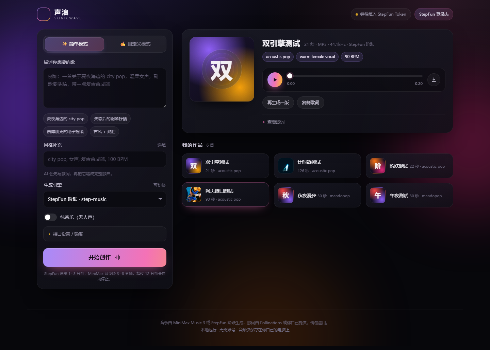

# 声浪 SonicWave · AI 歌曲生成

参考 suno.cn 交互的本地网页：**输入一句话 → AI 写词 → 谱曲演唱 → 试听 → 下载**。两种引擎，页面上直接切换。



## 两种引擎

| | StepFun 阶跃（实验性） | MiniMax 网页登录态（实验性） |
| --- | --- | --- |
| 触发条件 | 填入 www.stepfun.com 的 `Oasis-Token` | 填入 www.minimax.cn 的登录 Token |
| 写词 | 本地歌词 / Pollinations | 官方歌词接口 / Pollinations |
| 音乐 | `step-music` | 网页版 `music-3.0` / `music-2.6` |
| 额度 | 账号音乐额度（示例账号 10 次） | 网页账号创作次数 |
| 输出 | MP3 · 44.1kHz | MP3 · 44.1kHz |
| 实时试听 | 不支持 | 不支持 |

在创作面板的「生成引擎」下拉里切换。两个 Token 可以同时保存在浏览器里，切换引擎不需要重新粘贴。

> MiniMax 官方音乐 API 已对新用户下线（错误 2153），公益 Space 引擎也已移除，所以现在只保留这两个网页登录态引擎。

### StepFun 阶跃音乐（实验性）

网页版内部接口，HTTP 提交 + 轮询：

- 提交：`POST https://www.stepfun.com/api/audio/capy.audio.v1.AudioService/SubmitMusicTask`
- 轮询：`.../GetMusicTask`，`MUSIC_TASK_STATUS_SUCCESS` 后返回 `audioUrl` 和 `duration`
- 额度：`.../GetQuota`（示例账号音乐额度共 10 次）
- 鉴权：`Oasis-Token` Cookie，格式是 `<access>...<refresh>`；服务端通过 `/passport/proto.api.passport.v1.PassportService/RefreshToken` 自动续期
- 固定模型 `step-music`，支持 `instrumental`；歌曲长度由歌词决定

**怎么拿 Token**：登录 <https://www.stepfun.com/studio/audio?tab=music> → DevTools → Application → Cookies → 复制 `Oasis-Token` 的完整值（中间有一个 `...` 分隔两段 JWT），整段粘到网页「接口设置 → StepFun 登录态」。

**注意**：

- access token 约 **30 分钟**过期，refresh token 约 30 天；服务端会先刷新。实测 access 过期后仍可用 refresh 换新，但如果 refresh 也失效，需要在网页重新复制。
- 会消耗账号的音乐生成额度，生成记录也会出现在阶跃的「我的作品」里。
- 非官方接口，可能随时失效；自动化使用可能不符合网站条款。
- 从 Render 海外机房访问 `stepfun.com` 可能较慢或被 WAF 拦截。

### 网页登录态（实验性）

网页版没有公开 API，走的是 `www.minimax.cn` 自己的 WebSocket：

- 连接：`wss://www.minimax.cn/v1/api/music/ws`，鉴权参数放在 URL 里
- 签名：`yy = md5(encodeURIComponent(path+query) + "_" + "{}" + md5(unix) + "ooui")`
- 消息：`MusicGen` / `Heartbeat` / `StopMusicGen`，音频以 MP3 分块流式下发，完成后可从历史列表拿到 CDN 地址
- 自动补全：等待 `status=2` 后取 `audio_url` / 时长 / 封面，再下载缓存

**怎么拿 Token**：登录 <https://www.minimax.cn/> → 打开 DevTools → Application → Local Storage → 复制 `_token` 的值（`eyJ...` 开头的 JWT），粘到网页「接口设置 → 网页登录态 Token」。

**必须知道的限制**：

- 这是**非官方接口**，不属于开放平台，可能随时失效；自动化使用也可能不符合网站条款，请自行评估风险。
- 会**消耗你网页账号的创作次数**，生成的歌也会出现在网页版的「我的作品」里。
- Token 大约 **40 天**过期（JWT 的 exp），过期后重新登录复制即可。
- Token 等同于账号登录态，**只在本机使用**；不要把服务开到公网，也不要把 Token 提交到代码仓库。
- 需要 **Node.js 22+**（用内置 WebSocket）。

## 歌词

简单模式下，歌词走 [Pollinations](https://pollinations.ai) 的 OpenAI 兼容接口（`POST /openai` 或 `/v1/chat/completions`），不需要 Key。也可以切到自定义模式自己写歌词。

## 运行

```bash
cd ai-song
node server.mjs
# 打开 http://127.0.0.1:8899
```

Windows 也可以直接双击 `start.bat`，会自动启动并打开浏览器。

**零依赖**，不需要 `npm install`。出站请求优先使用系统自带的 `curl`（Windows 10+ / macOS 自带），没有 curl 时回退 Node 原生 HTTPS。

## 部署到 Render

项目已内置 `render.yaml`、`/healthz` 健康检查、Render 的 `PORT`/`0.0.0.0` 适配，以及可选的 `ACCESS_PASSWORD` 访问密码。完整步骤见 **[DEPLOY_RENDER.md](DEPLOY_RENDER.md)**。

要点：用 Render Blueprint 连接 GitHub 私有仓库即可；公网实例**务必设置 `ACCESS_PASSWORD`**，并注意免费套餐的文件系统是临时的（歌曲重启会丢）。

## 功能

- **两种引擎**：StepFun 阶跃 / MiniMax 网页登录态，页面下拉切换
- **简单模式**：一句描述 → AI 写词 → 生成完整歌曲
- **自定义模式**：自己写歌词（`[Verse]` / `[Chorus]` 分段）+ 风格标签
- **纯音乐**：跳过人声（两个引擎都支持）
- **作品库**：自动保存到 `.cache/audio/`，刷新不丢，可下载 MP3
- 网页引擎会同时保存模型生成的封面图（CDN 地址）
- 生成过程中显示计时和缓动进度；**超过 12 分钟自动停止**
- 生成失败会给出明确原因（Token 失效、额度用完、网络等）

## 配置

| 环境变量 | 说明 | 默认 |
| --- | --- | --- |
| `SONICWAVE_PORT` | 端口 | `8899` |
| `HTTPS_PROXY` / `HTTP_PROXY` | 出站代理 | 自动读取 Windows 系统代理 |
| `PROXY=off` | 强制直连 | — |
| `STEP_TOKEN` | 服务器级 StepFun Oasis-Token（等价于网页里填） | 空 |
| `MM_WEB_TOKEN` | 服务器级 MiniMax 网页登录态 Token（等价于网页里填） | 空 |
| `MM_WEB_OP_TICKET` | 网页端的 op_ticket（一般不用填） | 空 |
| `MAX_CONCURRENT` | 同时生成的任务数 | `2` |
| `ACCESS_PASSWORD` | 公网访问密码（Basic Auth），设置后所有页面/接口都要密码 | 空（不启用） |
| `CACHE_DIR` | 音频缓存目录（挂载 Render Disk 时用） | `.cache` |

> 程序按这个顺序找网络通路：环境变量代理 → Windows「Internet 选项」里的系统代理 → 上次成功用过的代理（`.cache/proxy.json`）→ 自动探测本机常见代理端口（7890 / 7897 / 10809 / 10808 / 8888 / 1080 / 8080）。Pollinations 和 MiniMax 网页接口优先直连；StepFun 优先走代理（它的 WAF 对直连不太友好）。

## 目录

```
ai-song/
├── server.mjs          # 零依赖后端：双引擎 / 代理 / SSE / WS / 缓存
├── public/
│   ├── index.html
│   ├── styles.css
│   └── app.js          # 任务状态、作品库、引擎切换
├── .cache/audio/       # 生成的 MP3 + 元数据（可随时删除）
└── preview.png
```

## 实现说明

- **StepFun 引擎**：先刷新 token，再 `SubmitMusicTask` 提交、每 3 秒 `GetMusicTask` 轮询，成功后下载 `audioUrl`。
- **网页引擎**：服务端直连 WebSocket，心跳保活，等到 `status=2` 后用历史列表补全 `audio_url` / 时长 / 封面，再下载缓存。
- 两个引擎都没有流式进度，前端用缓动进度条示意；SSE 只转发状态和最终结果。
- curl 传输改成**先缓冲完整响应再返回**，避免代理 CONNECT 头或半截流把任务挂死；代理失败会先重试直连。
- 前端有 12 分钟看门狗，服务端网页任务 10 分钟超时，避免计时永远停不下来。

## 说明与限制

- 两个引擎都是**非官方、实验性**能力：可能随时失效，可能不符合网站条款，账号也可能因此受限，请自行判断。
- 请勿做成公开高并发服务，每一次生成都在真实消耗账号的额度。
- 只有本地服务，没有账号体系；如需局域网/公网访问，改 `HOST=0.0.0.0` 并设置 `ACCESS_PASSWORD`（**不要把带登录 Token 的实例无密码暴露到公网**）。
- 生成的音乐版权归相应模型/平台条款约束，商用前请自行确认。
- `.cache/audio/` 里带有开发时生成的测试曲，可直接删除。